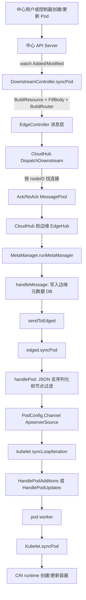
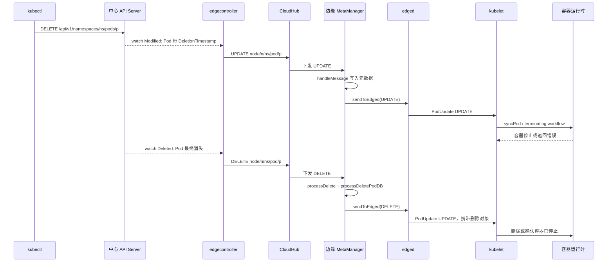
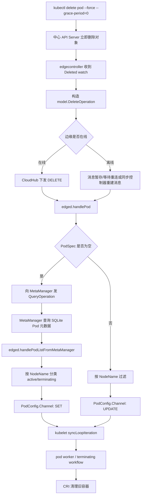
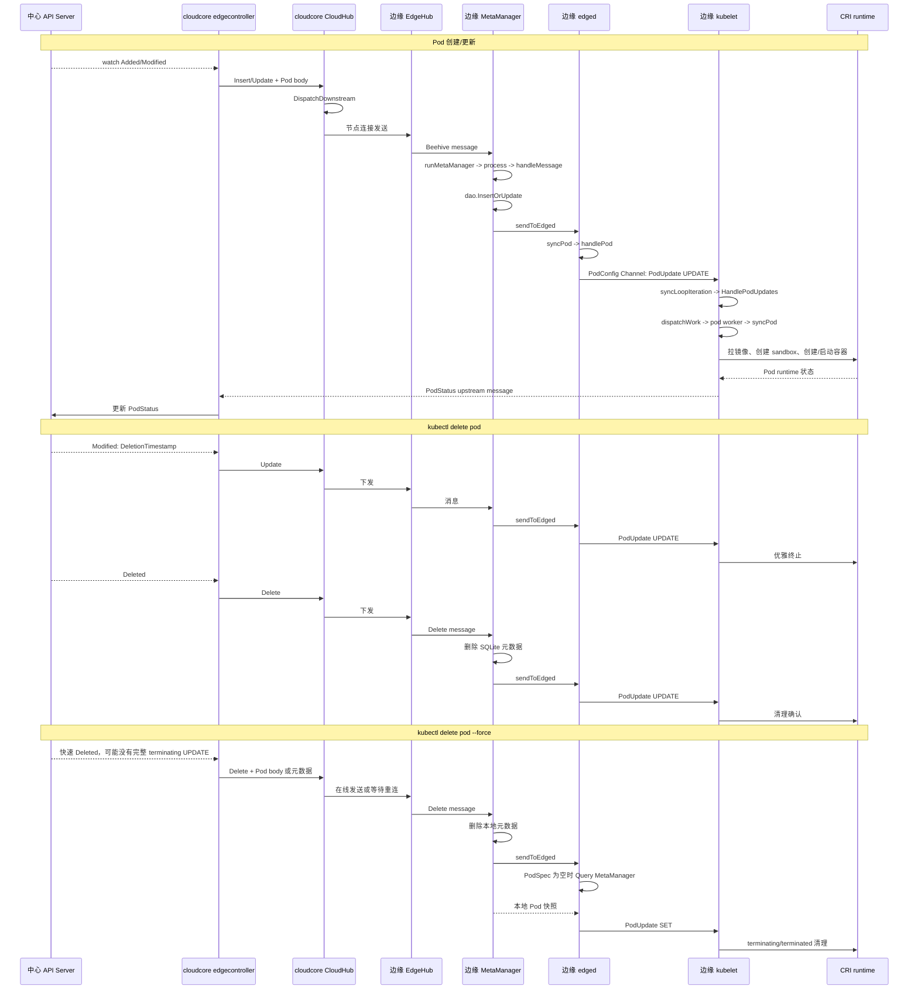

# Pod 从中心下发到边缘 kubelet 的完整链路

本文说明一个绑定到边缘节点的 Pod，从中心 Kubernetes API Server 产生变更开始，经 cloudcore、EdgeHub、MetaManager、edged，最终进入边缘 kubelet 的完整路径。

重点覆盖：

- Pod 创建/更新下发。
- `kubectl delete pod` 普通删除。
- `kubectl delete pod --force` 强制删除。
- 如何判断 Pod 卡在 `Pending` 时，消息究竟丢在哪一跳。

本文针对当前代码版本，函数名和路径以仓库实际实现为准。

## 一、先看结论

对于中心下发到边缘的 Pod，主路径是：

```text
中心 API Server watch
  -> cloud/pkg/edgecontroller/controller.DownstreamController.syncPod
  -> cloudcore 内部消息层
  -> cloud/pkg/cloudhub/dispatcher.messageDispatcher.DispatchDownstream
  -> CloudHub 到边缘节点的消息队列/连接
   -> edge/pkg/edgehub.(*EdgeHub).routeToEdge
   -> edge/pkg/edgehub.(*EdgeHub).dispatch
   -> edge/pkg/edgehub.defaultHandler.Process
   -> beehiveContext.SendToGroup(MetaGroup)
  -> edge/pkg/metamanager.metaManager.runMetaManager
  -> metaManager.handleMessage / processInsert / processUpdate / processDelete
  -> edge/pkg/metamanager.sendToEdged
  -> edge/pkg/edged.(*edged).syncPod
  -> edged.handlePod
  -> kubelet PodConfig.Channel
  -> kubelet syncLoopIteration
  -> Kubelet.HandlePodAdditions / HandlePodUpdates / HandlePodRemoves
  -> kubelet pod worker
  -> Kubelet.syncPod 或删除 worker
  -> CRI runtime
```

需要特别注意：

1. `kubectl` 不会直接请求边缘 kubelet。中心 API Server 的 Pod 事件先由 cloudcore 观察，再通过 CloudHub 下发。
2. `kubectl delete pod --force` 影响的是中心 API Server 中对象的删除语义。它不会在 edged 中产生一种名为 `FORCE_DELETE` 的独立消息操作；下游通常仍然是 `model.DeleteOperation`。
3. 边缘 edged 对普通 Pod 删除消息构造的是 `kubelettypes.PodUpdate{Op: UPDATE}`。kubelet 的 `DELETE` 配置事件本身也会被当作 UPDATE 处理，原因是需要执行优雅终止流程。
4. 当边缘离线期间 Pod 被中心强制删除，恢复连接后可能只有 namespace/name/UID 等元信息，缺少完整 `PodSpec`。edged 会识别这种情况，向 MetaManager 查询本地数据库快照，再通过 `SET` 方式恢复 kubelet 侧状态。

## 二、消息和对象如何串联

排查同一个 Pod 时，优先使用以下字段：

| 字段 | 用途 | 主要产生位置 |
| --- | --- | --- |
| `messageID` | 串起一次 Beehive 消息处理 | cloudcore、MetaManager、edged 日志 |
| `resource` | 定位节点、namespace、资源类型和 Pod 名称 | `node/<node>/<namespace>/pod/<name>` 一类资源路由 |
| `operation` | 判断 INSERT、UPDATE、DELETE、RESPONSE | `model.Message` Router |
| Pod namespace/name | 对应 Kubernetes 对象 | Pod metadata |
| Pod UID | 区分同名重建 Pod，尤其重要于删除 | Pod metadata / DeleteOptions precondition |
| `resourceVersion` | 判断中心 watch 事件版本 | edgecontroller 下发消息 |
| `DeletionTimestamp` | 判断是否进入删除中状态 | Pod metadata |

本次链路日志中的关键固定级别日志包括：

- `Dispatching downstream message to edge`
- `Enqueued downstream ack message` / `Enqueued downstream no-ack message`
- `MetaManager received message`
- `MetaManager handling message`
- `MetaManager sending message to edged`
- `Edged received message`
- `Edged sending pod update to kubelet`
- `Edged skipped pod for another node`
- `Kubelet received pod update`
- `Kubelet syncPod started`
- `Kubelet syncPod completed`
- `Kubelet syncPod failed`

## 三、正常创建或更新流程

### 3.1 流程图



### 3.2 逐步代码位置

| 步骤 | 模块 | 函数和文件 | 主要动作 |
| --- | --- | --- | --- |
| 1 | 中心 edgecontroller | `DownstreamController.syncPod`，`cloud/pkg/edgecontroller/controller/downstream.go` | 从 `podManager.Events()` 读取中心 Pod watch 事件；只处理边缘节点 Pod。 |
| 2 | 中心 edgecontroller | 同上 | 用 `messagelayer.BuildResource` 构造资源路由；用 `FillBody(pod)` 填入 Pod；Added 映射为 `InsertOperation`，Modified 映射为 `UpdateOperation`。 |
| 3 | cloudcore | `messageDispatcher.DispatchDownstream`，`cloud/pkg/cloudhub/dispatcher/message_dispatcher.go` | 从 CloudHub 消息源接收消息，解析 `nodeID`，检查是否发往边缘、节点连接是否存在。 |
| 4 | cloudcore | `enqueueAckMessage` / `enqueueNoAckMessage`，同上 | 将消息放入目标节点的 ACK 或 NO-ACK 队列，等待连接发送。 |
| 5 | 边缘 EdgeHub | `(*EdgeHub).routeToEdge` -> `(*EdgeHub).dispatch`，`edge/pkg/edgehub/process.go` | 从 EdgeHub 网络客户端读取消息并交给消息 handler。 |
| 6 | 边缘 EdgeHub | `defaultHandler.Process`，同上 | 根据消息 group 映射到 `MetaGroup`，通过 `beehiveContext.SendToGroup` 投递给 MetaManager；同步响应则走 `SendResp`。 |
| 7 | 边缘 MetaManager | `(*metaManager).runMetaManager`，`edge/pkg/metamanager/process.go` | 从 MetaManager 模块队列接收消息并调用 `m.process`。 |
| 8 | 边缘 MetaManager | `handleMessage` + `processInsert` / `processUpdate` | 解析资源类型，将 Pod 元数据写入 SQLite；对来自 edgecontroller 的消息调用 `sendToEdged`。 |
| 9 | 边缘 edged | `(*edged).syncPod`，`edge/pkg/edged/edged.go` | 从 edged 模块队列接收消息，解析资源和内容，调用 `handlePod`。 |
| 10 | 边缘 edged | `handlePod` | 反序列化 Pod，按 `pod.Spec.NodeName` 过滤；构造 `kubelettypes.PodUpdate{Op: UPDATE}`，写入 `PodConfig.Channel`。 |
| 11 | kubelet | `syncLoopIteration`，`vendor/k8s.io/kubernetes/pkg/kubelet/kubelet.go` | 从 PodConfig updates channel 取出 UPDATE；调用 `HandlePodUpdates`。ADD 场景则调用 `HandlePodAdditions`。 |
| 12 | kubelet | `HandlePodUpdates` / `HandlePodAdditions` | 更新 pod manager，调用 `dispatchWork` 把 Pod 投递给 pod worker。 |
| 13 | kubelet | `syncPod`，同上 | 执行 admission、卷、网络、镜像、容器运行时等工作；失败会返回错误并重试。 |

## 四、普通 `kubectl delete pod` 流程

### 4.1 中心删除阶段

用户执行：

```bash
kubectl delete pod <pod-name> -n <namespace>
```

中心 API Server 会处理删除请求。删除是否立即完成取决于 Pod 的 finalizer、优雅终止时间以及 API Server 当前对象状态。对象进入删除流程后，edgecontroller 的 Pod informer 会收到 Modified 事件；对象从 API Server 中消失后，会收到 Deleted 事件。

`DownstreamController.syncPod` 对中心 watch 事件的映射是：

- `watch.Modified` -> `model.UpdateOperation`，消息体通常包含带 `DeletionTimestamp` 的完整 Pod。
- `watch.Deleted` -> `model.DeleteOperation`，消息体来自 informer 删除事件对象。

因此，普通删除经常会有两个可观察阶段：

1. 带 `DeletionTimestamp` 的 UPDATE 到达边缘，kubelet 开始终止 Pod。
2. 最终 DELETE 到达边缘，边缘清理元数据和运行态。

### 4.2 删除时序图



### 4.3 边缘删除代码路径

1. MetaManager 收到 `DeleteOperation` 后进入 `processDelete`。
2. Pod 类型会调用 `handleMessage`，其中再调用 `processDeletePodDB`，删除本地 Pod 元数据和 Pod patch 元数据。
3. 删除成功后调用 `sendToEdged`。
4. edged 的 `handlePod` 反序列化删除消息。只要能按节点过滤，就构造 `PodUpdate{Op: UPDATE}` 写入 kubelet，而不是直接写 `REMOVE`。
5. kubelet 在 `syncLoopIteration` 中对配置源事件执行分发。Kubernetes kubelet 对 `DELETE` 配置事件的注释明确说明：DELETE 会按 UPDATE 处理，以支持 graceful deletion。
6. pod worker 根据 Pod 的删除状态进入 terminating/terminated workflow，最终调用 kubelet 的删除逻辑和 CRI runtime。

## 五、`kubectl delete pod --force` 流程

用户执行：

```bash
kubectl delete pod <pod-name> -n <namespace> --force --grace-period=0
```

不同 kubectl 版本可能对 `--force` 给出确认提示；`--grace-period=0` 通常与 `--force` 一起使用。本文重点是服务端和边缘链路，不讨论客户端提示差异。

### 5.1 `--force` 改变了什么

`--force` 的核心影响是：中心 API Server 可以不等待 kubelet 或节点确认终止，直接完成对象删除。对边缘链路有三个后果：

1. 中心对象可能很快从 API Server 消失，边缘不一定先收到一个完整的 terminating UPDATE。
2. 如果边缘在线，edgecontroller 通常仍会从 informer 的 Deleted 事件构造 `model.DeleteOperation` 并下发。
3. 如果边缘离线，等边缘恢复时，中心已经没有这个 Pod 的完整对象。同步控制器可能只能下发 namespace/name/UID 等删除元信息，无法依靠完整 `PodSpec` 做节点过滤。

因此，`--force` 不是“让 edged 直接强杀容器”的命令。它是中心侧的强制删除；边缘是否还能清理旧容器，取决于删除消息能否到达、消息是否包含完整 Pod、MetaManager 本地是否保留元数据，以及 kubelet/CRI 是否能完成清理。

### 5.2 强制删除时的特殊分支

edged 的 `handlePod` 有专门判断：

```go
if op == model.DeleteOperation && reflect.DeepEqual(pod.Spec, v1.PodSpec{}) {
    // 查询 MetaManager 的本地 Pod 快照
}
```

代码位置：`edge/pkg/edged/edged.go` 的 `(*edged).handlePod`。

这条分支对应的场景是：

- 边缘离线时中心强制删除 Pod。
- 边缘重新上线，收到只包含 Pod 名称、namespace、UID 等元数据的 DELETE。
- 因为 `PodSpec` 为空，edged 无法用 `filterPodByNodeName` 判断该 Pod 是否属于本节点。
- edged 向 MetaManager 发送 Pod `QueryOperation`。
- MetaManager 从 SQLite 查询 Pod 列表并响应。
- edged 在 `handlePodListFromMetaManager` 中按节点重新筛选，并将结果以 `PodUpdate{Op: SET}` 写给 kubelet。
- 其中带 `DeletionTimestamp` 的 Pod 放入 terminating 列表，交由 kubelet 后续清理。

对应流程图：



### 5.3 `--force` 与 Pending 的关系

如果中心对象已经删除，但中心侧或边缘侧仍显示旧状态，需要先区分两件事：

- **中心 API Server 中的 Pod 状态**：来自中心对象或删除前最后一次状态回报。
- **边缘实际运行状态**：来自 edged/kubelet/CRI，以及边缘向中心回报的 PodStatus。

如果新 Pod 长期 `Pending` 且边缘没有启动，重点检查创建链路，而不是只检查删除链路：

1. 中心 edgecontroller 是否收到了 Added/Modified 事件。
2. `syncPod` 是否构造了正确的 node resource。
3. CloudHub 是否找到目标节点连接并成功入队。
4. MetaManager 是否收到并写入本地 DB。
5. edged 是否收到消息，是否因 `NodeName` 不匹配而过滤。
6. kubelet 是否收到 `PodUpdate`，是否进入 `HandlePodUpdates`。
7. `Kubelet.syncPod` 是否报 admission、镜像、卷、网络或 CRI 错误。

旧 Pod 的 `--force` 删除只解决旧对象的中心删除，不会自动修复新 Pod 的下发、节点绑定或 kubelet 执行失败。

## 六、完整时序图：创建、删除和状态回报



## 七、按日志排查的最短路径

### 7.1 创建或更新 Pod 没有启动

按下面顺序搜同一个 `resource`、Pod UID 或 `messageID`：

1. **中心 edgecontroller**
   - 代码：`DownstreamController.syncPod`
   - 关注：是否出现 Added/Modified，目标 Pod 的 `Spec.NodeName` 是否是预期边缘节点。
2. **cloudcore CloudHub**
   - 日志：`Dispatching downstream message to edge`
   - 关注：`node`、`resource`、`operation`、`resourceVersion`。
   - 如果没有这条日志，消息没有进入下发 dispatcher，或资源路由没有被识别为发往边缘。
3. **CloudHub 入队**
   - 日志：`Enqueued downstream ack message` 或 `Enqueued downstream no-ack message`。
   - 如果出现 `node is not connected`，先排查 EdgeHub 连接。
4. **MetaManager**
   - 日志：`MetaManager received message`、`MetaManager handling message`。
   - 如果收到但随后有 `MetaManager failed to process message`，检查本地 DB、消息内容和资源路由。
5. **edged**
   - 日志：`Edged received message`。
   - 如果随后是 `Edged skipped pod for another node`，检查 Pod 的 `spec.nodeName` 和 edged 节点名。
   - 如果没有 `Edged sending pod update to kubelet`，说明消息在 edged 内部没有进入 kubelet 通道。
6. **kubelet**
   - 日志：`Kubelet received pod update`。
   - 如果有该日志但没有 `Kubelet syncPod started`，检查 kubelet pod worker/dispatchWork。
   - 如果有 `Kubelet syncPod failed`，以错误内容为准继续排查 admission、镜像、卷、网络或 CRI。

### 7.2 `--force` 后旧 Pod 仍然残留

1. 先确认中心 edgecontroller 是否收到 Deleted 事件。
2. 再确认 DELETE 消息是否到达 edged。
3. 检查 edged 是否打印 `Received metadata-only pod delete, refreshing pod snapshot from MetaManager`。
4. 检查 MetaManager 是否保留了该 Pod 的本地元数据；如果本地 DB 已被提前删除，查询无法恢复完整 Pod。
5. 检查 `Classified pod list from MetaManager before kubelet SET` 中该 Pod 是否出现在 `terminatingPods`。
6. 检查 kubelet 是否收到 SET/UPDATE，随后是否出现 `Kubelet syncPod failed` 或 CRI 删除错误。

## 八、容易混淆的边界

### cloudcore 与 edgecore

- cloudcore 负责观察中心 API Server、按节点路由、通过 CloudHub 下发。
- edgecore 的 EdgeHub 负责连接和消息传输。
- edgecore 的 MetaManager 负责边缘元数据缓存、落库和转发。
- edged 负责将 Pod 消息翻译成 kubelet 能消费的 `PodUpdate`。
- kubelet 负责真正的 Pod admission、容器生命周期和 CRI 调用。

### Pod 删除消息与 kubelet 删除动作

`model.DeleteOperation` 是 cloudcore/MetaManager 层的资源消息操作；它不等价于 kubelet 内部的某一个 `SyncPodType`。edged 当前把普通 Pod 删除消息封装为 PodUpdate，kubelet 再根据配置事件、Pod 删除状态和 pod worker 状态决定优雅终止或最终清理。

### 中心 Pending 与边缘没有容器

中心 Pod 处于 `Pending` 只能说明中心看到的 PodStatus 尚未进入 Running，不能单独证明消息没有下发。必须沿 `edgecontroller -> CloudHub -> MetaManager -> edged -> kubelet -> CRI` 逐跳核对。
